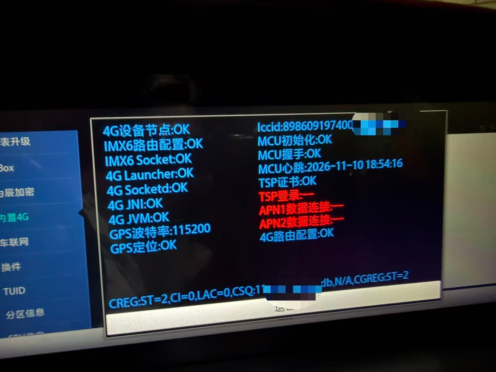
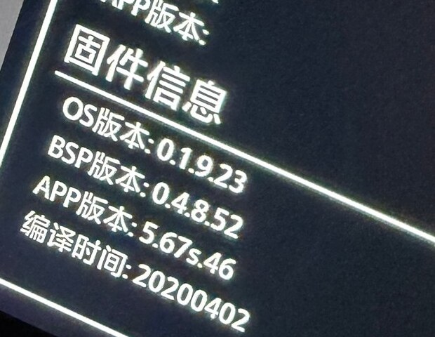

# 4G 网络故障处理 —— 「网络修复包」拆解、判定流程与实战复盘

> 适用：长安 CS75PLUS 2020 款（1.5T / 2.0T）车机 **S311-WT 平台**
> 本文档对应修复包：`CoagentUpgrade.zip`（106,229,622 B / 101.3 MiB）
> MD5 `a32b7e9c1bfb6e415b341de2aed1d243` · SHA256 `3f4528fef7963236b1f2d70d71b7a9092052617867556ccfe4b4662d49471085`

---

## 一、拆解结论：它不是一个「新固件」，而是 4G 模块固件的单独重刷包

解压后只有一个组件目录，**没有 OS、没有 MCU、没有语音数据**：

```
CoagentUpgrade/
└── Tbox/
    ├── tbox-os.tar.gz      100,092,261 B   ead3557546d0811b823dfb496298aca1
    ├── tbox-bsp.tar.gz       5,728,901 B   b05b97dc59c47da16c864d09d7d07060
    ├── tbox-app.tar.gz         402,821 B   5f5aba5ce584e5a517eac02eaf2b55b0
    ├── tbox_version.txt             78 B   buildTime=20191212 / 0.1.9.23 / 0.4.7.51 / 5.67s.46
    ├── tbox_versions.txt            78 B
    ├── md5.txt                     155 B
    └── ReleaseNote.md            8,202 B
```

### 逐字节比对结果（7/7 全部相同）

| 文件 | 修复包内 MD5 | `v0.98.00-191227` 的 TBOX MD5 | 结论 |
|---|---|---|---|
| `tbox-os.tar.gz` | `ead35575…98aca1` | `ead35575…98aca1` | **完全相同** |
| `tbox-bsp.tar.gz` | `b05b97dc…d07060` | `b05b97dc…d07060` | **完全相同** |
| `tbox-app.tar.gz` | `5f5aba5c…2b55b0` | `5f5aba5c…2b55b0` | **完全相同** |
| `ReleaseNote.md` | `695a5fb4…` | `695a5fb4…` | 完全相同 |
| `md5.txt` / `tbox_version.txt` / `tbox_versions.txt` | — | — | 完全相同 |

**结论**：所谓「网络修复包」= **`v0.98.00-191227` 发布版里 TBOX（4G 模块）那一份，原样单独打包**。
没有新代码、没有新版本号，它做的事只有一件：**把车机里 4G 模块的固件与配置整体覆写回原厂状态**。

> 这也是为什么它的叫法容易误解 —— 它不「打补丁」，它是**重装 4G 模块**。

## 二、它到底重写了哪一层

车机里有三个相对独立的固件域：

| 域 | 作用 | 本包是否触碰 |
|---|---|---|
| **OS**（`Os/update.zip`，~1 GB） | 车机 Android 系统、界面、应用 | ❌ 不碰 |
| **MCU**（`McuAppUpdate.img`，470 KB） | 仪表/空调/车身逻辑、电源管理 | ❌ 不碰 |
| **TBOX**（本包，~101 MB） | **4G 通信模块**（移远 Quectel **AG35** 模组）、TSP 云端接入、证书、唤醒 | ✅ **只重写这一层** |

TBOX 三件套对应的内容：

- `tbox-os` —— 4G 模组自身的 Linux 系统（移远 AG35 平台）
- `tbox-bsp` —— 板级驱动、射频/功耗、休眠唤醒、拨号与网络守卫
- `tbox-app` —— 车联网业务程序（心跳上报、远程控制、大数据、短信唤醒）

依据原厂发版记录（见 [TBOX 发版记录](TBOX-发版记录-191227.md)），这一层里还承载着**最容易被写坏、也最常导致「有信号上不了网」的东西**：

- TSP 接入配置 `server.conf`（域名/端口/协议）
- `terminal.conf` / `upgrade.conf`（终端参数、升级配置）
- 根证书库、AES 密钥、与 SE 安全芯片的交互
- APN、`rmnet_data*` 网卡路由、DHCP 获取、弱网/无网时的 cfun 切换策略

> ⚠️ 说明：`tbox-*.tar.gz` 三个文件**不是真正的 gzip**（头部不是 `1F 8B`），而是厂商**加密容器**，与主 OS 镜像同属加密格式，无法离线解包查看内部。以上内容依据是原厂发版记录，不是解包所见。

## 三、能修什么、修不了什么

### ✅ 能修（都是「软件/数据层」故障）

| 现象 | 原因 | 为什么重刷有效 |
|---|---|---|
| 4G 图标有信号，但**上不了网 / 一直转圈** | `server.conf`、证书、APN 数据被写坏 | 整体覆写回原厂配置 |
| 4G **完全无信号 / 不注册网络** | 模组固件状态异常、升级中途断电遗留 | 重刷 os+bsp+app 三层 |
| 远程控制（开空调、解锁）失效 | TSP 证书 / 密钥异常 | 证书与密钥随固件恢复 |
| 频繁掉线、出车库不自动重连 | 网络守卫逻辑/路由数据损坏 | 恢复原厂网络策略 |
| 语音/网络唤醒短信异常 | 唤醒配置损坏 | 恢复 |
| 升级过程中断导致 4G 变砖 | 固件区被破坏 | 可恢复（只要硬件没坏） |

### ❌ 修不了（刷完还是不行 → 指向硬件）

| 可能原因 | 说明 |
|---|---|
| 4G 模块本体烧毁 | 搭电/电压冲击最常见后果 |
| 供电电路、**保险丝**熔断 | 模块压根没上电，刷什么都不会有反应 |
| 天线 / 射频线束脱落、锈蚀 | 有电但无信号 |
| SIM / 流量卡欠费、停机、锁卡 | 先确认卡状态再谈刷机 |
| 运营商侧问题、当地基站覆盖 | 换位置对比测试 |

## 三·五、故障现场截屏（同款故障对照）

下面是**同款故障**的车机工程模式状态页实拍，如果你车机显示的界面也长这样，对照本文即可判断：



> 实拍时间 2026-11-10，MCU 心跳时间戳可见；ICCID 与信号强度已做打码处理。

### 逐项读图

| 屏幕项目 | 显示值 | 含义 | 说明什么 |
|---|---|---|---|
| `4G设备节点` | **OK** | 主控能看到 4G 模组 | 模组**没被完全烧死**，供电与通信通道在 |
| `IMX6路由配置` | OK | 主控（IMX6）路由表正常 | 主控侧软件正常 |
| `IMX6 Socket` | OK | 主控 Socket 服务正常 | 同上 |
| `4G Launcher` / `4G Socketd` / `4G JNI` / `4G JVM` | 全部 **OK** | 4G 业务进程、守护进程、JVM 都在跑 | **APP 层没崩**，不是应用软件问题 |
| `GPS波特率` | 115200 | 模组串口参数 | 串口通信正常 |
| `GPS定位` | OK | 定位可用 | 模组 GPS 功能正常 |
| `Iccid` | 已读到（打码） | SIM 卡被识别 | **卡在位、卡没坏**（未欠费仍需另行确认） |
| `MCU初始化` / `MCU握手` / `MCU心跳` | OK / OK / 带时间戳 | 主控与 MCU 通信正常 | 车身控制侧无异常 |
| `TSP证书` | **OK** | 车联网证书**有效** | ◳ **证书没坏** → 不是证书过期问题 |
| `TSP登录` | **--（红色）** | 无法登录车联网平台 | 数据通道不通导致的连锁失败 |
| `APN1数据连接` | **--（红色）** | 第一路 APN 未建立 | **拨号没成功** |
| `APN2数据连接` | **--（红色）** | 第二路 APN 未建立 | **拨号没成功** |
| `4G路由配置` | OK | 4G 侧路由配置正常 | 配置文件本身在 |
| 底部 `CREG:ST=2` | 已注册本地网络 | 模组成功附着到运营商网络 | **射频、卡鉴权、基带注册都成功** |
| 底部 `CSQ:1x` | 信号强度（打码） | CSQ 0~31，越大越好 | 若数值很低，先换位置排除信号覆盖 |

### 这张图说明了什么（关键）

一屏看下来是**典型的分层结果**：

```
模组供电/通信    ✅ OK         4G设备节点、Socket、JNI、JVM
SIM 卡识别       ✅ OK         Iccid 已读到
网络注册         ✅ OK         CREG:ST=2（已注册本地网络）
证书             ✅ OK         TSP证书 OK
─────────────────────────────────────────────
数据拨号         ❌ 失败       APN1 / APN2 都是 "--"
云端登录         ❌ 失败       TSP登录 "--"（因为没网，跟着失败）
```

**结论：硬件「不是全坏」，但数据面不通。** 具体只有三种可能：

| 可能 | 性质 | 刷修复包能解决吗 |
|---|---|---|
| ① APN / 拨号脚本 / 路由配置被写坏 | 软件（配置） | ✅ 能（重刷会覆写回原厂配置） |
| ② 模组基带/PDP 上下文异常（数据面协议栈错乱） | 软件（固件状态） | ✅ 大概率能 |
| ③ 模组的射频/基带数据通路出现物理损伤（能注册、不能建 PDP） | 硬件 | ❌ 不能，需拆机维修 |

> 正是因为这个状态**同时包含「硬件活着」和「数据面死掉」两种特征**，才必须靠「刷一次」来区分 ——
> 刷完 APN 变 OK → 属 ① / ②；刷完 APN 依然 `--` → 属 ③，直接走硬件维修（见第六节）。

### 补充排查（刷之前先做这几件事，很便宜）

1. **确认流量卡**：ICCID 能读到只说明卡在，不代表没欠费/没停机——用手机插同卡或查运营商端状态；
2. **看 CSQ**：若信号值明显偏低（如个位数），先驶离地下车库/空旷处复测，排除覆盖问题；
3. **核对 APN**：部分车机允许在工程模式里看 APN 参数，若被改成异常值，也可能只是配置问题；
4. **冷复位**：先按第六节方案 1 整车断电 5~10 分钟，再看 APN 是否恢复——这一步能免费排除「模组假死」。

## 三·六、进阶证据：车机实际 TBOX 版本与运行状态 dump

> ⚠️ **这一节决定了「你该刷哪个包」**，比状态页更关键。以下数据来自同款故障车的「模块信息」与「4G 自检 dump」页面，
> 截图中已剔除 ICCID / IMEI 等个人信息，仅保留固件版本相关部分。

### 1. 车机实际 TBOX 固件（模块信息页）



| 项目 | 车机实际值 | 对应版本 |
|---|---|---|
| 模组型号 | **AG35**（移远 Quectel） | — |
| OS 版本 | `0.1.9.23` | 各版相同 |
| **BSP 版本** | **`0.4.8.52`** | **`v1.09.00-200512`** |
| APP 版本 | `5.67s.46` | 191227 / 200512 相同 |
| **编译时间** | **`20200402`** | **`v1.09.00-200512`** |

### 2. 但应用层 dump 自报的版本是旧的

「4G 自检 / dump state」页的 JSON 里写着：

| 字段 | 值 | 对应版本 |
|---|---|---|
| `baseStatus.bspVersion` | `0.4.7_51_20191212` | `v0.98.00-191227` |
| `baseStatus.appVersion` | `5.67s_46_20191212` | `v0.98.00-191227` |
| `baseStatus.osVersion` | `0.1.9_23_20191212` | `v0.98.00-191227` |
| `baseStatus.4GVendor` | `quectel` | 移远 |

**两处不一致**（同一时段 18:54:02 与 18:54:16 抓的）：

| 数据源 | BSP 版本 | 说明 |
|---|---|---|
| 「模块信息」页（读**模组实际固件**） | **0.4.8.52 / 20200402** | 车机模组真实跑的是 **200512 版** |
| 「dump state」（读**应用层记录**） | 0.4.7.51 / 20191212 | 应用层版本描述仍停在 **191227** |

> 这与此前发现的「200512 版原厂没更新 TBOX 发版记录」是同一类现象：**200512 的 TBOX 包只换了固件本体，应用层的版本描述没有同步**。
> 所以判断车机真实版本，**以「模块信息」页为准**。

### 3. dump 里最关键的几个字段（判定硬件的依据）

| 字段 | 值 | 含义 |
|---|---|---|
| `apn1Active` | **`false`** | 第一路 APN 未激活（与状态页 `APN1数据连接:--` 一致） |
| `apn2Active` | **`false`** | 第二路 APN 未激活 |
| `socketConnect` / `socketWorking` | `true` / `true` | 本地 socket 服务正常工作（软件栈没崩） |
| `analysis.firstBBStartConnTime` | **`0`** | 开机以来**从未发起过**一次有效的 BB 连接流程完成 |
| `analysis.firstBBConnSuccessTime` | **`0`** | 开机以来**从未成功连接** |
| `analysis.firstBBLoginTime` | **`0`** | 从未成功登录 |
| `analysis.firstApn1ConnTime` | **`0`** | 从未建立 APN1 |
| `analysis.firstApn2ConnTime` | **`0`** | 从未建立 APN2 |
| `analysis.awakeBBConnSuccessTime` | `0` | 唤醒后也从未成功 |
| `currentBootTime` | `5,753,894 ms` ≈ **95.9 分钟** | 车机已开机约 96 分钟 |
| `jvmBootTime` | `5,706,166 ms` ≈ 95.1 分钟 | 业务 JVM 在开机约 48 秒后启动 |

**这组数据的含义非常明确**：

> 车机已经开机 **95 分钟**，这 95 分钟里 **`firstApn1ConnTime` / `firstApn2ConnTime` / `firstBBConnSuccessTime` 全是 0**
> —— 意味着**一次都没有成功拨号过**，不是「偶尔掉线」，而是**从来没连上**。
> 同时 `socketConnect/socketWorking` 都是 `true`，说明**软件栈是活的**。
> 软件活着 + 从未连上 + APN 无法激活 → 高度指向**数据面硬件/供电**，而不是证书或配置。

### 4. 由此得出的「该刷哪个包」

| 你的车机「模块信息」页 BSP 版本 | 应使用的修复包 | 说明 |
|---|---|---|
| `0.4.7.51` / 编译 `20191212` | **本仓库这个修复包**（191227 的 TBOX） | 同版本重刷，安全 |
| `0.4.8.52` / 编译 `20200402` | ⚠️ **不要用本包**（属降级） | 应从 `v1.09.00-200512` 完整包中取 TBOX 重刷（见 v1.09.00-200512 分仓） |
| 其他版本 | 先到「模块信息」页记录版本 | 以「同版本或更新」为原则 |

> ⚠️ **重要**：如果你的车机是 200512 的 TBOX（0.4.8.52），直接刷本包（0.4.7.51）属于**版本回退**：
> 轻则被升级程序拒绝，重则把模组降回旧版。**刷前务必先在「模块信息」页核对 BSP 版本。**

## 四、判定流程（关键结论）

```
4G 无法联网
   │
   ├─ ① 先查卡：SIM/流量卡是否欠费、是否被锁、车机是否识别到 IMEI/ICCID
   ├─ ② 再查信号：驶离地下车库/空旷处对比，确认不是运营商覆盖问题
   ├─ ③ 查保险丝：确认 4G 模块供电回路保险丝完好
   │
   ├─ ④ 刷入本修复包（重刷 TBOX 三件套）
   │      │
   │      ├─ 恢复 → 属于软件/证书/配置类故障，已修复 ✅
   │      │
   │      └─ 仍无法联网
   │            → 软件层已被彻底排除（原厂固件整层重写仍无效）
   │            → **基本可 100% 判定为硬件故障**：模块本体损坏或保险丝熔断
   │
   └─ ⑤ 硬件故障的两个处理动作（下面第六节）
```

> 一句话：**这个包既是「修复包」，也是「排查工具」** —— 刷了没用，就说明软件没问题，别再折腾刷机了，直接走硬件路线。

## 五、我的故障复盘（真实案例）

**经过**：

1. 车辆未启动，长时间在车内使用车机（听歌 / 看视频 / 充电），导致**电瓶亏电**；
2. 使用另一台车**搭电**启动；
3. 之后车机 4G 模块失效 —— 有 SIM、有信号格却无法联网，远程控制全部失效。

**机理推断**：

- 亏电状态下长时间让车机深度放电，4G 模块处于**反复欠压/异常掉电**状态，容易写坏配置区（证书、`server.conf`）；
- 更有杀伤力的是**搭电瞬间**：电压尖峰、极性接反、负载突降都会冲击 TBOX 的供电电路，轻则配置损坏（可刷回），重则**模块或保险丝直接烧毁**（刷不回来）。
- 这就是为什么「先刷机、刷不好就是硬件」这套判定特别适用于搭电后的故障 —— 它把「配置写坏」和「芯片烧毁」两种情况一次性区分开。

**成本对比（很重要）**：

| 渠道 | 报价 | 说明 |
|---|---|---|
| 4S 店 | **约 2000 元** | 只换不修：整块车机总成更换 |
| 网上送修 | **约 100 元** | 拆下主机寄修，维修 4G 模块/供电电路 |

> 差价 20 倍。如果判定为硬件故障，**先别急着花 2000**，拆机送修是很成熟的方案。

## 六、解决路径（按成本从低到高，建议按顺序）

### 方案 1：整车彻底断电冷复位（0 元，先试）

有些 TBOX 异常是「假死」，模组需要**完全断电**才能复位（车机休眠不等于断电）：

1. 熄火、下车、钥匙远离车辆，等待车机完全休眠（约 5 分钟）；
2. 打开机舱，**先拆电瓶负极（-），再拆正极（+）**；
3. 保持断开 **5~10 分钟**；
4. 先装正极，再装负极，上电启动，观察 4G 是否恢复；
5. 若恢复 → 属于 TBOX 假死，无需维修。

> ⚠️ 拆装电瓶有风险（可能触发防盗、车窗/天窗需重新初始化、部分车型需做节气门学习）。不确定就让修理厂做，或直接跳过到方案 2/3。

### 方案 2：刷入本「网络修复包」（0 元）

用于修复证书 / TBOX 数据异常。步骤见第七节。**刷完仍不通 = 硬件故障**。

### 方案 3：拆车机送修（约 100 元）

1. 拆下中控车机主机（需要撬棒 + 螺丝刀，B 站有 CS75PLUS 拆装视频）；
2. 寄给网上维修商家，说明「4G 模块不联网，搭电后出现的」；
3. 常见维修内容：更换 4G 模块、修复供电电路/保险丝、重焊；
4. 费用约 100 元，远低于 4S 的 2000 元只换不修。

### 方案 4：4S 更换总成（约 2000 元）

仅在保修内免费更换、或上述方案都不接受时才考虑。

## 七、刷入「网络修复包」的步骤

> 🚨 **第 0 步（必做）**：先进入车机「模块信息」页，记录 **BSP 版本**。
> 本包是 **0.4.7.51（191227）**；若你的车机是 **0.4.8.52（200512）**，请勿用本包，改用 200512 的 TBOX（见第三节·六）。

1. U 盘格式化为 **FAT32**（建议 8 GB 以上）；
2. 解压 `CoagentUpgrade.zip`，把整个 **`CoagentUpgrade/` 文件夹**（里面只有 `Tbox/`）放到 U 盘**根目录**：

```
U盘根目录/
└── CoagentUpgrade/
    └── Tbox/
        ├── tbox-os.tar.gz
        ├── tbox-bsp.tar.gz
        ├── tbox-app.tar.gz
        ├── tbox_version.txt
        ├── tbox_versions.txt
        └── md5.txt
```

3. 车辆 **ACC ON（不点火）**，插入 U 盘；
4. 车机点「**系统升级**」→「**USB 升级**」；
5. 确认版本显示为 `0.1.9.23 / 0.4.7.51 / 5.67s.46` 后点「一键安装」；
6. **升级约 5~10 分钟，全程禁止断电、禁止拔插 U 盘**，完成后自动重启；
7. 重启后观察 4G 图标与网络状态，尝试打开在线音乐/导航验证。

> 本包只含 TBOX，因此**不会改变**你的 OS 版本、MCU 版本、语音数据 —— 刷完「关于」里的系统版本号不会变，属正常现象，不要误以为没刷进去。

## 八、下载

| 平台 | 位置 | 状态 |
|---|---|---|
| GitHub | [Releases · `tbox-netfix-191227`](https://github.com/a10463981/cs75plus-2020-1.5T/releases/tag/tbox-netfix-191227) | 原包单文件直下 |
| Gitee | [cs75plus-2020-1.5T-netfix](https://gitee.com/a10463981/cs75plus-2020-1.5T-netfix) | 因单附件 100 MB 限制，拆成 2 个分卷 |

**校验值**（下载后必对）：

```
MD5    a32b7e9c1bfb6e415b341de2aed1d243
SHA256 3f4528fef7963236b1f2d70d71b7a9092052617867556ccfe4b4662d49471085
```

## 九、常见疑问

**Q：刷了这个包，OS 版本会变成 191227 吗？**
A：**不会。** 包里只有 TBOX，不含 OS。系统版本号保持不变，只有 4G 模块固件被重写。

**Q：刷完还是没网，还能再刷几次吗？**
A：可以但没意义。原厂固件整层重写两次都无效，说明软件层已被排除，重复刷只会浪费时间，直接按硬件故障处理。

**Q：只是「信号弱/经常掉线」，值得刷吗？**
A：可以先试。信号弱若由网络守卫策略或路由数据异常引起，重刷能改善；若是天线/环境问题则无效。

**Q：刷完 4G 正常了，以后还会再坏吗？**
A：如果根因是欠压/搭电冲击，只要不再发生类似事件，配置不会再被写坏。建议：**别在熄火状态下长时间用车机**，这是本案例的起点。

---

> ⚠️ 免责：本文为车主个人经验与归档分析，非官方维修手册。刷机有风险，拆电瓶/拆车机有安全与质保风险，请自行评估；固件版权归原厂所有。
